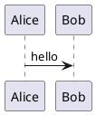

# PlantUML 围栏与图形编辑

Markdown 可以用 `plantuml` 或 `puml` 代码围栏嵌入图表：

图表在 Markdown 预览和思维导图画布中由本机 PlantUML 渲染。点图表面板的“GUI 编辑”可打开并行工作区，在 GUI 操作、PUML 源码和实时预览之间切换；“同步到 Markdown”会把修改写回同一段围栏。

## GUI 支持范围

结构化编辑器识别时序图、类图、活动图、用例图、组件图、部署图、状态图和 ER 图。可添加图元与关系、修改名称和关系说明、编辑类成员、添加注释和分组；时序图还可创建 `alt`、`opt`、`loop` 与激活区间，活动图可创建步骤、判断和泳道。方向、宏、条件预处理器、样式和未知语句保留在 PUML 源码中；未识别图表仍支持源码编辑和渲染。

GUI 只修改解析到的语句，并将新语句插入图表结束标记之前。遇到复杂或无法识别的语法时，使用 PUML 源码编辑可避免改变其原文。PlantUML 负责自动布局，GUI 不提供任意拖拽定位。

## 本机渲染与安全

- 应用随包携带 PlantUML MIT 许可 JAR `1.2026.8` 与许可证文本。
- 运行时需要 Java 11 或更高版本。应用检查 `JAVA_HOME`、`PATH` 和常见安装目录；Java 不存在或版本过低时会显示安装提示。
- 找不到 Graphviz `dot` 时使用内置 Smetana 布局。
- 单次输入上限为 50 KB，渲染超时为 15 秒，SVG 输出上限为 300 KB。
- 本地和远程 include 默认均禁止。在工作区显式选择并授权文件夹后，仅该目录可用于本地 include；远程 include 仍不开放。关闭工作区后授权不会保存。
- SVG 在写入界面前会经过应用的安全清理；脚本、外链、图片和 HTML 回调不会进入渲染页面。

参考：[PlantUML MIT 发布](https://github.com/plantuml/plantuml/releases/tag/v1.2026.8)、[安全配置](https://plantuml.com/security)、[布局引擎](https://plantuml.com/layout-engines)。
